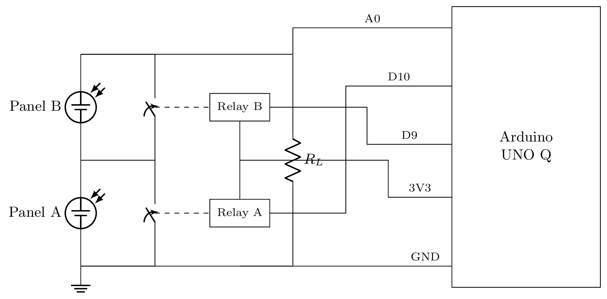

# Solar Cells Optimizer

Live diagnosis and power optimization for a string of solar panels, on an **Arduino UNO Q**. A sketch on the MCU drives per-panel bypass relays and streams raw current readings over the Bridge; a Python App Lab app on the Linux side turns that into a web dashboard that either lets you drive the relays by hand or lets an exhaustive-search optimizer automatically find the relay combination that maximizes power output — while, in the background, deducing *why* any one panel is underperforming (shaded, dirty, defective, or just cloudy out).

## Hardware

Panels are wired in series through a shared load resistor `R_L`, with one relay per panel wired in parallel across it. Closing a relay bypasses (shorts out) that panel, excluding it from the string. The MCU reads the voltage across `R_L` on `A0` — that's the only sensor in the whole rig; every per-panel reading is obtained by isolating one panel at a time via the relays, never by having a dedicated sensor per panel.



*(source: [`docs/circuit.tex`](docs/circuit.tex), built with [circuitikz](https://circuitikz.github.io/); rebuild with `pdflatex circuit.tex` inside `docs/`)*

| Pin | Function |
|---|---|
| `A0` | voltage across `R_L` (0–3.3 V, 14-bit ADC) |
| `D10` | Relay A, in parallel with Panel A |
| `D9` | Relay B, in parallel with Panel B |

`R_L = 10 Ω`. Adding a third panel is one line in [`sketch/hardware.hh`](sketch/hardware.hh) — nothing else in the firmware or the app hardcodes a panel count; see [Why it's built this way](#why-its-built-this-way).

**Never close every relay at once** — that would bypass every panel simultaneously, leaving nothing in the string. Both the firmware and the optimizer enforce this as a hard rule, not just a convention.

## How the measurement works

With `N` panels, a relay mask selects which panels are bypassed. Reading `R_L`'s voltage under a given mask tells you the current flowing through whichever panels are *not* bypassed:

- mask with nothing bypassed → the current of the whole series string (limited by the weakest panel in it)
- mask with every panel but one bypassed → that one panel's own current, isolated

The firmware doesn't know any of this — it's a thin layer: it drives relays on command and streams raw ADC samples. All interpretation (volts, mA, mW, which mask means what) lives in Python.

## Architecture

```
sketch/            MCU firmware (C++, arduino:zephyr core)
  cell.hh            the Cell type: one relay + its state
  hardware.hh         the concrete board config: pins, the CELLS[] array
  led_matrix.hh        the onboard 8x13 LED matrix, as a scrolling bar graph
  sketch.ino            setup()/loop(): relay control + sample streaming

python/             Linux side (App Lab, python-apps-base container)
  main.py             Bridge glue, the exhaustive-search optimizer, the web API
  cell.py               per-panel diagnostic state (baseline, ratio, event log)
  diagnostics.py          the pool of checks that deduces each panel's status

assets/
  index.html          the dashboard (plain HTML/CSS/JS, Pico CSS, no build step)
  libs/pico.min.css     vendored locally so the dashboard works with no internet
```

### MCU ↔ Linux protocol (Arduino Bridge RPC)

| Direction | Name | Payload |
|---|---|---|
| MCU → Linux | `"ready"` (notify) | fired once from `setup()` |
| MCU → Linux | `"sample"` (notify, ~20 Hz) | `[t_ms, raw_adc, bypass_mask]` |
| Linux → MCU | `get_cell_count()` (call) | → number of panels |
| Linux → MCU | `set_relay(index, bypassed)` (call) | → `1` applied, `0` refused (would bypass every panel), `-1` bad index |

`set_relay` does its safety check and the `digitalWrite` synchronously, right in the Bridge handler — a deliberate, documented departure from the usual "handler copies, `loop()` applies" pattern, justified because the handler makes no `Serial`/`Bridge` calls (the actual risk that pattern guards against) and it buys the caller a truthful, immediate answer instead of inferring success from the next pushed sample.

## The dashboard

Open `http://<board>.local:7000/` (or the board's IP). Two modes:

- **Manual** — you choose which panel(s) to bypass, with live current/voltage/power readouts and a scrolling chart.
- **Optimization** — an exhaustive search tries every valid relay combination (3 states at 2 panels, 7 at 3, …), measures each one's settled current, and holds the best. It re-searches periodically, or immediately if the held current drops, so it tracks changing light without hammering the relays (rated ~100k cycles). While it searches, every "isolate panel `i`" reading it takes is also fed to that panel's diagnostics.

### Diagnostics

Each panel tracks a self-calibrating baseline (an adaptive running peak, same idea as the LED matrix's auto-ranging — no manual calibration step, no assumption about the real-world current range ahead of time) and a short rolling history of its ratio to that baseline. A pool of independent checks turns that into a verdict:

| Verdict | Fires when |
|---|---|
| `healthy` | at or near its own baseline |
| `obstacle` | dropped sharply, alone (others normal) |
| `dirt` | declined gradually, alone |
| `defect` | stuck low for a while, while others are visibly varying — not just a passing shadow |
| `cloud` | every panel dropped together, sharply |
| `dust` | every panel declined together, gradually |
| `shaded` | every panel (or one panel) is low, but there isn't yet enough history to tell whether that's recent or longstanding |
| `unknown` | ratio is between "healthy" and "low" — genuinely ambiguous, not forced into a label |

That last one matters: a confident-sounding `dust` label when the system simply never saw a brighter reading to compare against is a worse answer than an honest "don't know yet" — `shaded` exists specifically so "not detected as sudden" doesn't silently get read as "therefore gradual."

Status changes are logged as timestamped spans (start, reason, confidence, and — once it changes — how long it lasted), not just a live snapshot, so "panel A has been flagged `dirt` for the last 40 minutes" is an answerable question. This log, plus each panel's baseline, is persisted to `data/diagnostics.json` and reloaded on the next App run.

### The onboard LED matrix

Independent of all of the above: the sketch also drives the UNO Q's 8×13 LED matrix as a live scrolling bar graph of the raw current, auto-ranged to its own recent peak. It needs nothing from the Linux side, so it keeps working even if the App Lab app isn't running.

## Running it

In Arduino App Lab: open this folder as an App, **Run**. The sketch compiles and flashes; the Python side starts the dashboard on port 7000. First boot: the Python side retries `get_cell_count()` every ~0.5 s until the sketch's Bridge handlers are registered — this is expected, not an error.

There's currently no simulated-data mode — every reading on the dashboard is a real measurement taken by actually switching relays. An earlier `simulate.py` existed for a previous version of the MCU↔Linux protocol and was removed when that protocol changed; it hasn't been rebuilt against the current one.
